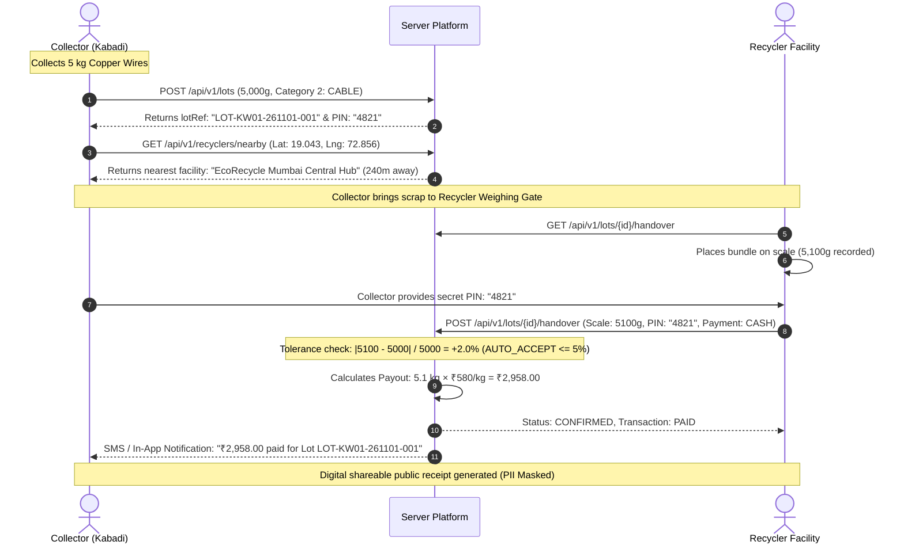

# ♻️ KABADI WALA: Circular E-Waste Supply Chain Platform
> **Complete Project Architecture, User Workflow, API Reference & Test Guide**

---

## 📖 1. Executive Summary

In informal waste markets, millions of **Kabadis (local scrap collectors)** collect electronic waste (E-Waste)—such as smartphones, computers, PCBs, and lithium batteries. However, this informal economy suffers from three systemic failures:

1. **Information Asymmetry:** Collectors do not know the real daily spot rates of electronic scrap and get heavily underpaid by middlemen.
2. **Hazardous Informal Processing:** Lack of safety training leads to acid leaching of motherboards, open burning of PVC copper cables, and smashing of lead-heavy CRT monitors.
3. **Traceability Deficit:** Authorized recyclers cannot verify provenance, leading to illegal dumping and lack of audit trails for Extended Producer Responsibility (EPR).

**KABADI WALA** bridges street-level scrap collectors with government-verified E-Waste recycling facilities through:
* **Real-time Price Discovery:** Ground-truthed median prices across 7 categories in local languages (Hindi & Marathi).
* **Cryptographic & Physical Verification:** 4-digit mutual verification PINs, GPS geofencing, and scale tolerance checks (±5%).
* **Privacy-Preserving Digital Receipts:** Shareable, tamper-proof receipts that mask collector personal identifying information (PII).
* **Automated Anomaly Detection:** Real-time flagging of 2x/3x price outliers, 25%/40% weight discrepancies, and GPS velocity spoofing.

---

## 👥 2. User Roles & System Personas

```
┌─────────────────┐       ┌─────────────────┐       ┌─────────────────┐       ┌─────────────────┐
│  1. COLLECTOR   │       │  2. RECYCLER    │       │ 3. FIELD AGENT  │       │   4. ADMIN      │
│  (कबाड़ीवाला)    │       │  (फैक्ट्री)     │       │  (फील्ड साथी)   │       │   (प्लेटफ़ॉर्म) │
├─────────────────┤       ├─────────────────┤       ├─────────────────┤       ├─────────────────┤
│ • 4-digit PIN   │       │ • Verified Scale│       │ • Onboard users │       │ • EPR Reporting │
│ • Lot Creation  │       │ • Rate Setting  │       │ • Price Surveys │       │ • License Check │
│ • Price Alerts  │       │ • Pickup Fleet  │       │ • Safety Audio  │       │ • Anomaly Flags │
│ • Cash / UPI    │       │ • Handover Conf │       │ • ML Dataset    │       │ • Audit Trail   │
└────────┬────────┘       └────────┬────────┘       └────────┬────────┘       └────────┬────────┘
         │                         │                         │                         │
         └─────────────────────────┴────────────┬────────────┴─────────────────────────┘
                                                ▼
                                    ┌───────────────────────┐
                                    │ KABADI WALA PLATFORM  │
                                    │ Next.js 15 + Prisma   │
                                    └───────────────────────┘
```

### 1. Collector (कबाड़ीवाला)
* Accesses mobile-first responsive web or offline-first mobile app.
* Authenticates using a **10-digit mobile number** and **4-digit PIN** (no complex passwords).
* Creates scrap bundles ("Lots") with approximate weights and photos.
* Receives a deterministic **4-digit Handover PIN** for secure transfer.

### 2. Recycler (अधिकृत रिसाइक्लर)
* Must hold a verified State Pollution Control Board authorization (e.g., `EW-MH-2026-0042`).
* Sets daily buying rates per kg in integer paise (₹1 = 100 paise).
* Weighs scrap on precision scales at the facility gate.
* Confirms handovers by verifying the collector's 4-digit code.

### 3. Field Agent (फील्ड साथी)
* Conducts weekly ground surveys of local scrap market prices.
* Onboards informal collectors, records consent, and assigns unique short codes (e.g. `KW01`).
* Distributes 4 core safety modules (burning cables, acid leaching, batteries, CRT breaking).

### 4. Platform Admin (मालिक)
* Audits facility licenses and automatically expires out-of-date certifications.
* Investigates automated anomaly flags (Price disparities, Weight disparities, Duplicate photos).
* Exports analytical market price data for circular economy research.

---

## 🔄 3. End-to-End Operational Workflow



### Weight Discrepancy & Tolerance Engine
* **≤ 5.0% discrepancy:** `AUTO_ACCEPT` — Automatically approved and final price recalculated on exact scale weight.
* **> 5.0% and ≤ 15.0% discrepancy:** `MANUAL_REVIEW` — Collector must explicitly confirm the new weight on their screen.
* **> 25.0% or > 40.0% discrepancy:** `ANOMALY_TRIGGERED` — Transaction paused; flagged for administrative audit.

---

## 🗃️ 4. Material Categories & Spot Rates

All rate data is strictly represented in **Integer Paise per Kilogram** (₹1.00 = 100 paise) to avoid floating-point rounding errors:

| ID | Code | Material Name (English) | Material Name (Hindi) | Default Spot Rate |
| :---: | :--- | :--- | :--- | :---: |
| **1** | `PCB` | Printed Circuit Board | सर्किट बोर्ड (PCB) | **₹340.00 / kg** (34,000 paise) |
| **2** | `CABLE` | Copper Wires & Cables | तार और केबल | **₹580.00 / kg** (58,000 paise) |
| **3** | `BATTERY` | Batteries (Li-Ion / Lead) | बैटरी (खतरनाक) | **₹90.00 / kg** (9,000 paise) |
| **4** | `CRT` | CRT Monitors / Leaded Glass | सीआरटी स्क्रीन | **₹12.00 / kg** (1,200 paise) |
| **5** | `LCD` | LCD & LED Panels | एलसीडी स्क्रीन | **₹45.00 / kg** (4,500 paise) |
| **6** | `MOTOR_MAGNET` | Motors & Compressors | मोटर और कंप्रेसर | **₹140.00 / kg** (14,000 paise) |
| **7** | `MIXED_PLASTIC`| E-Waste Casing Plastic | प्लास्टिक केसिंग | **₹8.00 / kg** (800 paise) |

---

## 🔑 5. Pre-Seeded Test Credentials

| Persona | Phone | Password / PIN | Identifier | Notes |
| :--- | :---: | :---: | :--- | :--- |
| **Collector** | `9820000001` | **`1234`** | `KW01` | Dharavi Matunga Labour Camp |
| **Recycler** | `9876543210` | **`password123`** | `EW-MH-2026-0042` | EcoRecycle Mumbai Central Hub |
| **Field Agent** | `9830000001` | **`agent123`** | `FA-MUM-01` | Ground Survey & Onboarding |
| **Platform Admin** | `9999999999` | **`admin123`** | `SYS-ADMIN` | Complete Platform Governance |

---

## ⚡ 6. Core REST API Specifications

### 1. Collector Authentication (`POST /api/v1/auth/login`)
* **Endpoint:** `POST /api/v1/auth/login`
* **Description:** Validates 10-digit mobile and 4-digit PIN with rate limiting (5 attempts lock out for 15 mins).

#### Request Body:
```json
{
  "phone": "9820000001",
  "pin": "1234"
}
```

#### Response (`200 OK`):
```json
{
  "success": true,
  "data": {
    "token": "eyJhbGciOiJIUzI1NiIsInR5cCI6IkpXVCJ9...",
    "user": {
      "id": "cm7user001",
      "phone": "9820000001",
      "role": "COLLECTOR",
      "language": "HI",
      "collector": {
        "id": "cm7col001",
        "shortCode": "KW01",
        "operatingArea": "Dharavi Matunga Labour Camp"
      }
    }
  }
}
```

---

### 2. Scrap Spot Rate Board (`GET /api/v1/prices/board`)
* **Endpoint:** `GET /api/v1/prices/board`
* **Description:** Public daily price board aggregating market range, median rate, and 30-day directional trends (`UP`, `DOWN`, `FLAT`).

#### Response (`200 OK`):
```json
{
  "success": true,
  "data": {
    "date": "2026-11-01",
    "categories": [
      {
        "categoryId": 2,
        "code": "CABLE",
        "nameEn": "Wires & Copper Cables",
        "nameHi": "तार और केबल",
        "medianPricePerKgPaise": 58000,
        "medianPricePerKgRupees": 580,
        "minPriceRupees": 560,
        "maxPriceRupees": 600,
        "trend": "UP"
      }
    ]
  }
}
```

---

### 3. Payout Estimation Engine (`POST /api/v1/estimate`)
* **Endpoint:** `POST /api/v1/estimate`
* **Description:** Calculates estimated payout and confidence range (±10%) based on historical price points.

#### Request Body:
```json
{
  "categoryId": 2,
  "approxWeightGrams": 5000
}
```

#### Response (`200 OK`):
```json
{
  "success": true,
  "data": {
    "categoryId": 2,
    "approxWeightKg": 5.0,
    "estimatedPayoutPaise": 290000,
    "estimatedPayoutRupees": 2900.0,
    "priceRangeRupees": {
      "min": 2610.0,
      "max": 3190.0
    },
    "ratePerKgRupees": 580.0
  }
}
```

---

### 4. Create Collection Lot (`POST /api/v1/lots`)
* **Endpoint:** `POST /api/v1/lots`
* **Headers:** `Authorization: Bearer <token>`
* **Description:** Initializes a lot, generates human-readable reference, and assigns 4-digit PIN.

#### Request Body:
```json
{
  "categoryId": 2,
  "approxWeightGrams": 5000,
  "conditionNotes": "High-grade PVC copper wiring",
  "deviceLat": 19.0434,
  "deviceLng": 72.8567
}
```

#### Response (`201 Created`):
```json
{
  "success": true,
  "data": {
    "id": "cm7lot001",
    "lotRef": "LOT-KW01-261101-001",
    "status": "READY",
    "approxWeightGrams": 5000,
    "verificationCode": "4821",
    "createdAt": "2026-11-01T10:00:00.000Z"
  }
}
```

---

### 5. Nearby Recycler Geo-Discovery (`GET /api/v1/recyclers/nearby`)
* **Endpoint:** `GET /api/v1/recyclers/nearby?latitude=19.0434&longitude=72.8567&radiusKm=10`
* **Description:** Returns sorted list of active facilities with Haversine distance, verified credentials, and pickup availability.

#### Response (`200 OK`):
```json
{
  "success": true,
  "data": [
    {
      "id": "cm7rec001",
      "name": "EcoRecycle Mumbai Central Hub",
      "address": "Plot 12, Dharavi Cross Road, Dharavi",
      "distanceKm": 0.24,
      "authorizationStatus": "VERIFIED",
      "contactPhone": "9876543210",
      "pickupAvailable": true
    }
  ]
}
```

---

### 6. Handover Mutual Verification (`POST /api/v1/lots/{id}/handover`)
* **Endpoint:** `POST /api/v1/lots/{id}/handover`
* **Description:** Submitted by Recycler Gate Staff to verify PIN, test weight tolerance, confirm payout, and generate digital receipt.

#### Request Body:
```json
{
  "verificationCode": "4821",
  "scaleWeightGrams": 5100,
  "paymentMode": "CASH",
  "latitude": 19.045,
  "longitude": 72.858
}
```

#### Response (`200 OK`):
```json
{
  "success": true,
  "data": {
    "status": "CONFIRMED",
    "toleranceResult": "AUTO_ACCEPT",
    "weightDiffGrams": 100,
    "finalPriceRupees": 2958.0,
    "receiptToken": "rcpt_982a7f01cba4",
    "paymentStatus": "PAID"
  }
}
```

---

### 7. Shareable Privacy-Preserved Receipt (`GET /api/v1/receipts/{token}`)
* **Endpoint:** `GET /api/v1/receipts/{token}`
* **Description:** Returns tamper-evident public receipt with collector PII masked (e.g. `982****001`).

#### Response (`200 OK`):
```json
{
  "success": true,
  "data": {
    "receiptNumber": "RCPT-20261101-4821",
    "lotRef": "LOT-KW01-261101-001",
    "date": "2026-11-01T10:30:00Z",
    "collectorCode": "KW01",
    "recyclerFacility": "EcoRecycle Mumbai Central Hub",
    "authorizationNo": "EW-MH-2026-0042",
    "material": "Wires & Copper Cables",
    "confirmedWeightKg": 5.1,
    "ratePerKgRupees": 580.0,
    "totalPaidRupees": 2958.0,
    "paymentMethod": "CASH",
    "status": "COMPLETED"
  }
}
```

---

## 🛠️ 7. Quickstart Development Guide

1. **Install Dependencies:**
   ```bash
   npm install
   ```

2. **Sync Database Schema & Seed Data:**
   ```bash
   npx prisma db push
   npx tsx prisma/seed.ts
   ```

3. **Run Test Suite:**
   ```bash
   npm test
   ```

4. **Start Development Server:**
   ```bash
   npm run dev
   ```

5. **Access Live Interfaces:**
   * **Collector Portal:** `http://localhost:3000/collector`
   * **Recycler Portal:** `http://localhost:3000/recycler`
   * **Root Landing Page:** `http://localhost:3000`
