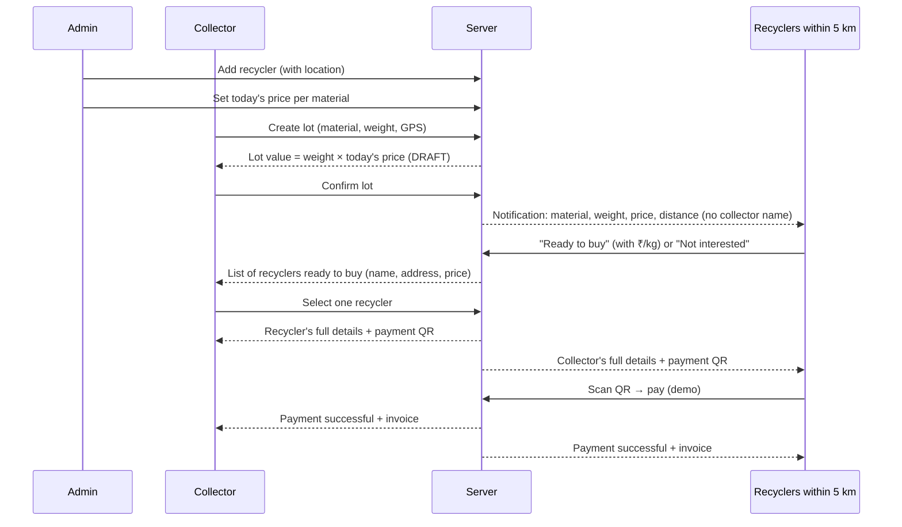

# Kabadi-Wala – App API Guide

How the platform works for **Admin**, **Collector** and **Recycler**, and the API endpoints the mobile app uses for each step.

---

## 1. Basics

| Item | Value |
|---|---|
| Base URL | `{server}/api/v1` (dev: `http://<your-PC-LAN-IP>:3000/api/v1`) |
| Auth | Header `Authorization: Bearer <token>`. Tokens last 30 days. |
| Success response | `{ "data": { ... } }` |
| Error response | `{ "error": { "code": "SOME_CODE", "message": "Readable message" } }` |
| Money | Integer **paise** (₹1 = 100). `ratePerKgPaise: 1000` = ₹10/kg |
| Weight | Integer **grams** (1 kg = 1000) |
| Dates | ISO-8601 UTC strings |

Common error codes: `UNAUTHORIZED` (401, no/invalid token), `FORBIDDEN` (403, wrong role), `NOT_FOUND` (404), `VALIDATION_ERROR` (400), `INVALID_STATE` / `NOT_OPEN` / `ALREADY_SELECTED` (409, the lot moved on – refresh and show the new state), `ACCOUNT_LOCKED` (429).

---

## 2. Overall flow



### Admin
1. Sign in → `POST /auth/staff-login`.
2. Add each recycler with its **exact latitude/longitude** → `POST /admin/recyclers`. Only recyclers within 5 km of a lot are notified, so the location must be right.
3. Every day, set **today's price** for each material → `POST /admin/prices/today`. A material without a price cannot be listed by collectors.
4. Approve / suspend recyclers when needed → `PATCH /admin/recyclers/{id}`. Only `VERIFIED` recyclers get lot requests.

### Collector
1. Register or sign in → `POST /auth/register` / `POST /auth/login` (phone + 4-digit PIN).
2. Show materials with today's price → `GET /prices/today`.
3. Create a lot (material + weight + phone GPS) → `POST /lots`. The response has the value, e.g. 10 kg × ₹10 = ₹100. Status `DRAFT`.
4. Collector checks the value and confirms → `POST /lots/{id}/confirm`. Status `READY`; recyclers within 5 km are notified.
5. Wait for recyclers. Poll `GET /lots/{id}/offers` (every 10–15 s while on the screen) to show who is ready to buy, with price and address. Use `POST /lots/{id}/search-again` if nobody is in range yet.
6. Pick one → `POST /lots/{id}/select`. Status `MATCHED`. The response contains the recycler's full details and the payment QR link.
7. Show the payment QR (`deal.payUrl`) and wait. Poll `GET /lots/{id}/deal` until `paymentStatus` is `PAID`, then show the success screen and invoice.

### Recycler
1. Sign in → `POST /auth/staff-login` (phone + password given by admin).
2. See nearby lot requests → `GET /recycler/requests` (material, weight, price, distance, area – **no collector name or phone**).
3. Answer each request → `POST /recycler/requests/{offerId}` with `INTERESTED` (+ your ₹/kg) or `DECLINED`.
4. When a collector chooses you, the lot appears in `GET /recycler/deals` and you get a notification.
5. Open the deal → `GET /lots/{lotId}/deal` to see the collector's name, phone and lot location.
6. Pay: scan the collector's QR, take the token from the URL (`…/pay/{token}`) and call `POST /payments/{token}/demo-pay`. Show the success + invoice from the response.

> **Demo payment:** no real money moves. The QR encodes `{server}/pay/{token}`. Opening it in a browser also marks the deal paid and shows the invoice page `{server}/invoice/{token}`.

---

## 3. Statuses

**Lot (`status`)**

| Status | Meaning | Who acts next |
|---|---|---|
| `DRAFT` | Created, value shown, not sent yet | Collector confirms or deletes |
| `READY` | Sent to recyclers within 5 km | Recyclers answer; collector selects |
| `MATCHED` | Collector selected a recycler | Recycler pays |
| `COMPLETED` | Paid | – |

**Recycler offer (`offer.status`)**: `NOTIFIED` (not answered) → `INTERESTED` / `DECLINED` → `SELECTED` / `NOT_SELECTED`.

**Payment (`paymentStatus`)**: `UNPAID` → `PAID`.

---

## 4. API list

### 4.1 Auth

| Method | Path | Who | Description |
|---|---|---|---|
| POST | `/auth/register` | Public | Collector sign-up. Body: `name, phone, pin, operatingArea, district?, preferredLanguage? (HI/MR/EN)`. Returns `token` + `profile`. |
| POST | `/auth/login` | Public | Collector sign-in. Body: `phone, pin`. Locks for 15 min after 5 wrong PINs. |
| POST | `/auth/staff-login` | Public | Recycler / admin sign-in. Body: `phone, password`. Returns `token` + `profile` (`role`, `recyclerId`, `recyclerName`). |
| GET | `/auth/me` | Any signed-in user | Current profile: `role`, plus `collector` or `recycler` details. |
| POST | `/auth/change-pin` | Collector | Body: `oldPin, newPin`. |
| POST | `/auth/pin-recovery` | Public | Reset a forgotten PIN with `phone, shortCode, operatingArea, newPin`. |
| POST | `/auth/restore-on-new-phone` | Public | Sign in on a new device. Body: `phone, pin, deviceId`. |

### 4.2 Prices

| Method | Path | Who | Description |
|---|---|---|---|
| GET | `/prices/today` | Public | Every material with today's price (`ratePerKgPaise`, `null` if not set). Use it for the material picker. |
| GET | `/prices/board` | Public | Market price board (trends) per material. |
| GET | `/prices/history?categoryId=&days=30` | Public | Price history for one material. |

### 4.3 Collector – lots

| Method | Path | Who | Description |
|---|---|---|---|
| POST | `/lots` | Collector | Create a lot. Body: `categoryId, approxWeightGrams, latitude?, longitude?, id? (client UUID), photos? (storage keys)`. Returns the lot with `listedRatePerKgPaise` and `estimatedValuePaise`. Status `DRAFT`. Without GPS, the collector's registered area is used. |
| GET | `/lots?status=` | Collector | My lots, newest first. |
| GET | `/lots/{id}` | Collector (owner) | One lot with all its data. |
| DELETE | `/lots/{id}` | Collector (owner) | Delete a lot that is not paid. |
| POST | `/lots/{id}/confirm` | Collector (owner) | Confirm a `DRAFT` lot and notify recyclers within 5 km. Returns `recyclersNotified`. |
| POST | `/lots/{id}/search-again` | Collector (owner) | Notify recyclers that joined the 5 km area since the lot was confirmed. |
| GET | `/lots/{id}/offers` | Collector (owner) | Recyclers ready to buy: `offerId, recycler {name, address, lat/lng}, distanceKm, ratePerKgPaise, totalPaise`, plus counts (`notified, interested, waiting, declined`). |
| POST | `/lots/{id}/select` | Collector (owner) | Sell to one recycler. Body: `offerId`. Returns the `deal`. |
| GET | `/lots/{id}/deal` | Collector (owner), selected recycler, admin | Both parties' full details, `amountPaise`, `paymentStatus`, `payUrl` (for the QR), `invoiceUrl`, `payment`. |

### 4.4 Recycler

| Method | Path | Who | Description |
|---|---|---|---|
| GET | `/recycler/requests` | Recycler | Open lot requests within 5 km. Each has `offerId`, `status` (`NOTIFIED` / `INTERESTED`), `distanceKm` and `lot {material, approxWeightGrams, listedRatePerKgPaise, listedValuePaise, area}`. |
| POST | `/recycler/requests/{offerId}` | Recycler | Answer a request. Body: `{ "response": "INTERESTED", "ratePerKgPaise": 1000 }` or `{ "response": "DECLINED" }`. |
| GET | `/recycler/deals` | Recycler | Lots where a collector chose me: collector name/phone/area, `amountPaise`, `paymentStatus`. |

### 4.5 Payment & invoice

| Method | Path | Who | Description |
|---|---|---|---|
| POST | `/payments/{token}/demo-pay` | Collector / recycler of the deal, admin | **Demo** payment. Marks the deal `PAID` and returns the `deal` with `payment` (method, reference, amount, time). Safe to call twice. |
| GET | `{server}/invoice/{token}` (web page) | Anyone with the link | Invoice + "Payment successful" screen. Can be opened in a WebView. |

### 4.6 Admin

| Method | Path | Who | Description |
|---|---|---|---|
| POST | `/admin/prices/today` | Admin | Set today's prices. Body: `{ "prices": [{ "categoryId": 1, "ratePerKgPaise": 1000 }] }`. |
| GET | `/admin/recyclers` | Admin | All recyclers with status, location and staff phones. |
| POST | `/admin/recyclers` | Admin | Add a recycler + staff login. Body: `name, contactPhone, authorizationNo, authorizationValidTill?, address, area, district?, state?, latitude, longitude, serviceRadiusKm?, staffPhone, staffPassword`. |
| PATCH | `/admin/recyclers/{id}` | Admin | Body: `{ "status": "VERIFIED" | "SUSPENDED" | "EXPIRED", "notes"? }`. |
| GET | `/admin/prices/export` | Admin | Download all price records as CSV. |

### 4.7 Notifications

| Method | Path | Who | Description |
|---|---|---|---|
| GET | `/notifications` | Any signed-in user | My notifications and `unreadCount`. `dataJson.lotId` tells which lot to open. |
| POST | `/notifications/{id}/read` | Owner | Mark one as read. |
| POST | `/notifications/read-all` | Any signed-in user | Mark all as read. |
| POST | `/notifications` | Admin | Send a notification to a user. |

### 4.8 Other

| Method | Path | Who | Description |
|---|---|---|---|
| POST | `/uploads/presign` | Collector | Get an upload URL for a lot photo. Body: `filename, contentType?`. Upload the file, then pass `storageKey` in `photos` of `POST /lots`. |
| GET | `/ledger` | Collector | My earnings history. |
| GET | `/reference/bootstrap?since=` | Public | Reference data for offline caching: materials, safety topics, recyclers, areas. |
| GET | `/recyclers/nearby?latitude=&longitude=&radiusKm=25` | Public | Verified recyclers near a point (for a map). |
| GET | `/collection-points?latitude=&longitude=&radiusKm=30` | Public | Drop-off collection points nearby. |
| GET | `/receipts/{token}` | Public | Public receipt data (no personal details). |
| GET | `/health` | Public | Server and database health. |
| GET / POST | `/sync/pull`, `/sync/push` | Collector | Offline sync (see `docs/API.md`). |

### 4.9 Not part of the new flow – do not use in the app

| Path | Note |
|---|---|
| `POST /lots/{id}/match-recycler` | Retired (returns 410). Use `confirm` → `offers` → `select`. |
| `POST /lots/{id}/handover`, `/lots/{id}/bargain/*` | Old weighing / bargaining flow. |
| `GET /recyclers/match`, `POST /estimate`, `/pickup-requests`, `/coverage-requests`, `/field/*` | Old matching, estimates, doorstep pickup and field-agent features. |

---

## 5. Example: full collector + recycler flow

```http
# Collector creates a lot: 10 kg of material 2 at the phone's location
POST /api/v1/lots
Authorization: Bearer <collector-token>
{ "categoryId": 2, "approxWeightGrams": 10000, "latitude": 19.0434, "longitude": 72.8567 }
→ 201 { "data": { "lot": { "id": "L1", "status": "DRAFT", "listedRatePerKgPaise": 1000, "estimatedValuePaise": 10000 } } }

POST /api/v1/lots/L1/confirm
→ { "data": { "lotId": "L1", "status": "READY", "recyclersNotified": 10 } }

# Recycler sees and accepts the request
GET /api/v1/recycler/requests          (recycler token)
→ { "data": { "requests": [ { "offerId": "O7", "status": "NOTIFIED", "distanceKm": 2.3, "lot": { ... } } ] } }
POST /api/v1/recycler/requests/O7
{ "response": "INTERESTED", "ratePerKgPaise": 1100 }

# Collector sees who is ready and picks one
GET /api/v1/lots/L1/offers
→ { "data": { "summary": { "notified": 10, "interested": 5, ... }, "offers": [ { "offerId": "O7", "totalPaise": 11000, ... } ] } }
POST /api/v1/lots/L1/select
{ "offerId": "O7" }
→ { "data": { "deal": { "amountPaise": 11000, "paymentStatus": "UNPAID", "payUrl": "https://…/pay/ab12…", ... } } }

# Recycler scans the QR and pays (demo)
POST /api/v1/payments/ab12…/demo-pay     (recycler token)
→ { "data": { "result": "PAID", "deal": { "paymentStatus": "PAID", "payment": { "method": "UPI", "reference": "DEMO-1A2B3C4D" } } } }
```
